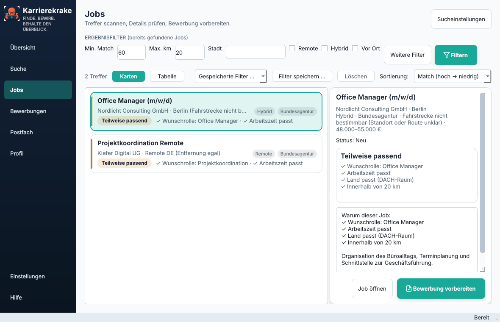
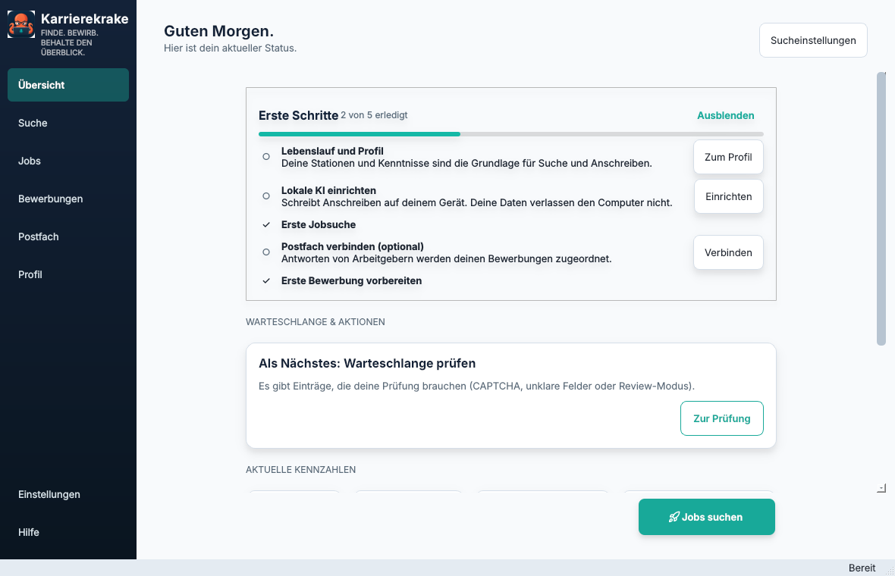
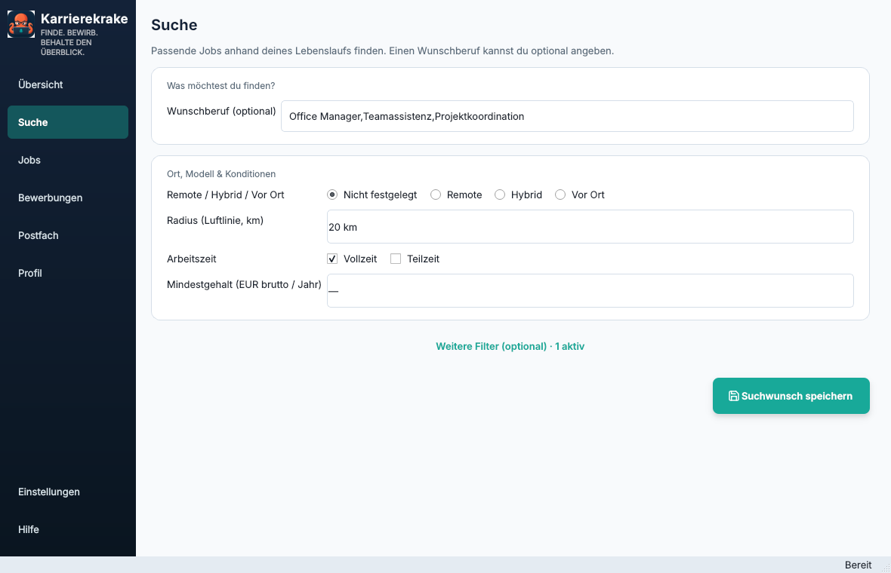
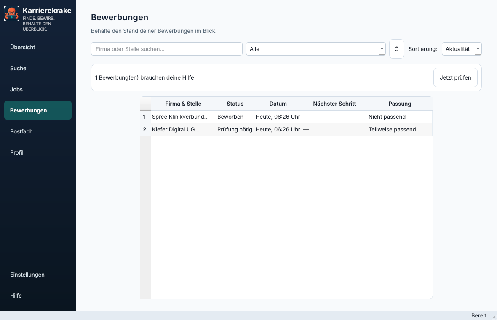
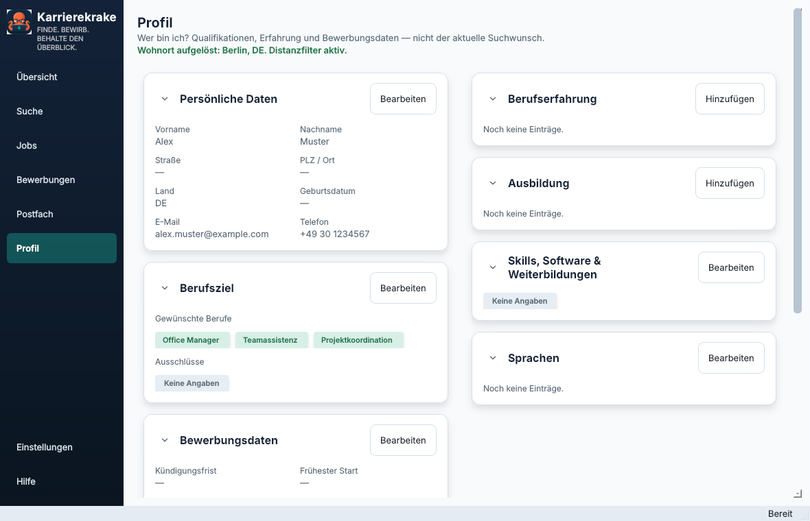
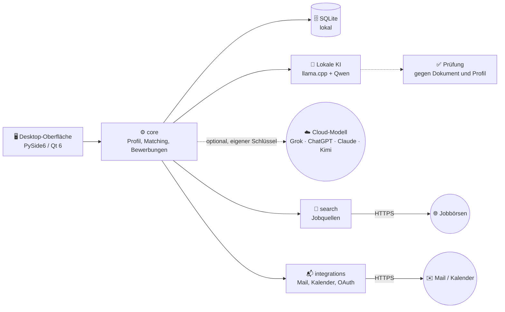

<p align="center">
  
</p>

<h3 align="center">FINDE. BEWIRB. BEHALTE DEN ÜBERBLICK.</h3>

<p align="center">
  Die Desktop-App für die Jobsuche, die auf deinem Rechner bleibt.<br/>
  Lebenslauf einlesen, passende Stellen finden, Anschreiben schreiben lassen, Bewerbungen verfolgen –<br/>
  <b>mit lokaler KI, ohne Cloud-Konto, ohne Abo, ohne Telemetrie.</b>
</p>

<p align="center">
  <a href="https://github.com/deadfrogface/Karrierekrake/actions/workflows/ci.yml"></a>
  <a href="https://github.com/deadfrogface/Karrierekrake/actions/workflows/windows-smoke.yml"></a>
  <a href="https://github.com/deadfrogface/Karrierekrake/actions/workflows/desktop-platforms.yml"></a>
  
  
  
  
</p>

<p align="center">
  
</p>

---

## 📑 Inhalt

- [✨ Was Karrierekrake kann](#-was-karrierekrake-kann)
- [📸 Oberfläche](#-oberfläche)
- [⚡ Gemessen](#-gemessen)
- [🔒 Datenschutz und Sicherheit](#-datenschutz-und-sicherheit)
- [📦 Installation](#-installation)
- [🧠 KI: lokal oder Cloud](#-ki-lokal-oder-cloud)
- [🏗️ Aufbau](#️-aufbau)
- [🧪 Qualitätssicherung](#-qualitätssicherung)
- [🛠️ Entwicklung](#️-entwicklung)
- [📚 Dokumentation](#-dokumentation)
- [⚖️ Lizenz](#️-lizenz)

---

## ✨ Was Karrierekrake kann

| | Funktion | Was dabei passiert |
|---|---|---|
| 📄 | **Lebenslauf einlesen** | PDF, Word, Text: Die lokale KI füllt Profil, Stationen, Ausbildung, Sprachen und Kenntnisse. Jede Angabe wird gegen das Dokument geprüft, bevor sie übernommen wird. |
| 🔎 | **Jobs finden** | Bundesagentur für Arbeit, Indeed, LinkedIn und Firmen-Karriereseiten; Duplikate werden zusammengeführt, Entfernungen über Postleitzahlen und Straßenrouting berechnet. |
| 🎯 | **Passung erklären** | Jede Stelle bekommt eine nachvollziehbare Bewertung: Wunschrolle, Arbeitszeit, Entfernung, Gehalt, Ausschlüsse – als Klartext, nicht als Blackbox-Zahl. |
| ✍️ | **Anschreiben schreiben** | Die lokale KI schreibt aus Profil und Anzeige. Eine Prüfung danach streicht erfundene Tools, Sprachen, Arbeitgeber und Zahlen, bevor du den Text siehst. |
| 📬 | **Postfach verbinden** | Gmail, Outlook oder IMAP: Antworten von Arbeitgebern werden der richtigen Bewerbung zugeordnet, Terminvorschläge erkannt. |
| 📅 | **Termine** | Google, Outlook, iCloud oder CalDAV: freie Zeiten prüfen, Vorstellungsgespräche eintragen – nur nach deiner Freigabe. |
| 📊 | **Überblick behalten** | Status jeder Bewerbung, nächste Schritte, Erinnerungen und ein Protokoll in Alltagssprache. |
| 🛡️ | **Du entscheidest** | Nichts wird ohne deine Freigabe abgeschickt. CAPTCHA, Zwei-Faktor und unbekannte Formulare stoppen immer vor dem Absenden. |

---

## 📸 Oberfläche

<table>
  <tr>
    <td></td>
    <td></td>
  </tr>
  <tr>
    <td align="center">🏠 Übersicht: nächster Schritt auf einen Blick</td>
    <td align="center">🔎 Suche: Wunschberuf, Ort, Arbeitszeit, Gehalt</td>
  </tr>
  <tr>
    <td></td>
    <td></td>
  </tr>
  <tr>
    <td align="center">📋 Bewerbungen: Status und nächster Schritt</td>
    <td align="center">👤 Profil: aus dem Lebenslauf befüllt</td>
  </tr>
</table>

Hell und Dunkel, Deutsch und Englisch, bis 200 % Bildschirmskalierung getestet.

---

## ⚡ Gemessen

Alle Zahlen stammen aus automatischen Läufen des **fertig gebauten Programms**, nicht aus Schätzungen.
Rechner: GitHub-Windows-Runner mit **2 physischen Kernen** – langsamer als die meisten Laptops.

| Ablauf | Zeit | Bemerkung |
|---|---:|---|
| 🚀 Programmstart bis bereit | **6,8 s** | gepacktes Programm, frisches Profil |
| 📄 Erster Lebenslauf-Import (Deutsch) | **110 s** | komplett offline, Modell Qwen3.5-4B |
| 📄 Jeder weitere Import | **46 s** | feste Anweisungen kommen aus dem Prompt-Cache |
| ✍️ Anschreiben | **90 s** | inklusive Prüfung auf erfundene Angaben |

**Was die letzten Optimierungen gebracht haben** (Entwicklungsrechner, gleiche Daten vorher und nachher):

| Verbesserung | Vorher | Nachher |
|---|---:|---:|
| Hauptfenster öffnet | 2,9 s | **≈ 1,3 s** |
| Anschreiben mit dem kleinen 4B-Modell | 231–289 s, oft ohne fertigen Brief | **91 s**, Brief im ersten Anlauf |
| 12 Lebensläufe mit dem 4B-Modell | 999 s | **815 s** (−18 %) |
| Text, den das Modell pro Anschreiben lesen muss | 100 % | **−17 bis −26 %** |
| Windows-Setup | 145 MB | **96 MB** |
| Windows-Programmordner | 402 MB | **290 MB** |

Jeder Paket-Lauf in der CI schreibt zusätzlich einen Größenbericht (größte Ordner und Dateien) und die Zeiten jedes
Modellaufrufs mit. Hintergrund und Methode: [`docs/PERFORMANCE.md`](docs/PERFORMANCE.md).

---

## 🔒 Datenschutz und Sicherheit

- 💻 **Alles lokal:** Profil, Bewerbungen und Mails liegen in einer SQLite-Datenbank im Benutzerordner.
- 🧠 **KI ohne Cloud als Standard:** Lebenslauf und Anschreiben werden auf deinem Rechner verarbeitet. Nach dem einmaligen Modell-Download braucht das kein Internet. Ein Cloud-Modell nutzt Karrierekrake nur, wenn du es mit eigenem Schlüssel einrichtest und zustimmst.
- 📵 **Keine Telemetrie**, kein Konto, keine Werbung.
- 🔑 **Zugangsdaten** (Mail, Kalender) im Schlüsselbund des Betriebssystems, nie im Klartext.
- 🧾 **Export und Löschen** aller eigenen Daten mit einem Klick (DSGVO Art. 15, 17, 20).

**Automatisch bei jedem Push geprüft** (CI-Job `security`):

| Prüfung | Werkzeug | Schranke |
|---|---|---|
| Bekannte Lücken in Abhängigkeiten | pip-audit, OSV-Scanner | jede offene Lücke |
| Statische Codeanalyse | Bandit | jeder Befund ab „mittel“ |
| Geheimnisse im Repo | Gitleaks | jeder Fund |
| Personenbezogene Daten im Repo | eigener Datenschutz-Scan | jeder Fund |
| Angriffe über Dateien und Texte | Sicherheitstests (Injection, kaputte PDFs/DOCX, ZIP-Bomben) | jeder Fehlschlag |

📄 Letzte Sicherheitsprüfung: [`docs/security/SECURITY_REVIEW_2026-11-19.md`](docs/security/SECURITY_REVIEW_2026-11-19.md) ·
Meldeweg für Lücken: [`SECURITY.md`](SECURITY.md) ·
Bedrohungsmodell: [`docs/security/local-data-threat-model.md`](docs/security/local-data-threat-model.md)

---

## 📦 Installation

| System | Paket | Daten liegen in |
|---|---|---|
| 🪟 Windows 10/11 | `Karrierekrake-…-Windows-Setup.exe` (empfohlen) oder `…-Windows-x86_64.zip` | `%LOCALAPPDATA%\Karrierekrake` |
| 🍎 macOS Apple Silicon | `Karrierekrake-…-macOS-AppleSilicon.dmg` | `~/Library/Application Support/Karrierekrake` |
| 🍏 macOS Intel | `Karrierekrake-…-macOS-Intel.dmg` | `~/Library/Application Support/Karrierekrake` |
| 🐧 Linux x86_64 | `Karrierekrake-…-Linux-x86_64.tar.gz` | `~/.local/share/Karrierekrake` |

1. **Setup starten** – Karrierekrake landet im Startmenü bzw. Programme-Ordner.
2. **Assistent folgen:** lokales KI-Modell einrichten → Lebenslauf einlesen → Suchwunsch → fertig.
3. **Jobs suchen.**

> 💡 **Hardware:** ab 8 GB RAM. Der Assistent misst den Rechner und schlägt das passende Modell vor;
> er erzwingt nie ein Modell, für das der Speicher nicht reicht.

Plattform-Details: [`docs/desktop-platforms.md`](docs/desktop-platforms.md)

---

## 🧠 KI: lokal oder Cloud

**Standard: lokal.** Die KI läuft auf deinem Rechner, offline und ohne laufende Kosten.

**Optional: Cloud-Modell mit eigenem API-Schlüssel** – Einstellungen → *KI-Anbieter wählen*:

| Anbieter | Anbindung | Einsatz |
|---|---|---|
| 🤖 **Grok** (xAI) | OpenAI-kompatible API | Lebenslauf einlesen und/oder Anschreiben |
| 💬 **ChatGPT** (OpenAI) | OpenAI-API | Lebenslauf einlesen und/oder Anschreiben |
| ✳️ **Claude** (Anthropic) | offizielles Anthropic-SDK | Lebenslauf einlesen und/oder Anschreiben |
| 🌙 **Kimi** (Moonshot AI) | OpenAI-kompatible API | Lebenslauf einlesen und/oder Anschreiben |

- 🔑 Schlüssel im Schlüsselbund des Systems, nie in einer Datei; die Modellliste kommt live vom Anbieter.
- ✋ Vor dem ersten Senden steht, **was** an **wen** geht; ohne Zustimmung geht nichts raus.
- ✅ Die Prüfung auf erfundene Angaben läuft **immer lokal**, auch bei Cloud-Antworten.
- 🗑️ „Nur lokal“ stoppt alles; „Alle Daten löschen“ entfernt auch Schlüssel und Auswahl.

Details: [`docs/cloud-ai.md`](docs/cloud-ai.md)

### Lokale Modelle

| Modell | Datei | ab RAM | Einsatz |
|---|---:|---:|---|
| Qwen3.5 **4B** | 1,9 GB | 8 GB | Standard für Laptops |
| Qwen3 **8B** | 4,1 GB | 16 GB | bessere Anschreiben |
| Qwen3.8 **27B** | 8,4 GB | 16 GB | höchste Qualität, langsamer |

- ⚙️ **llama.cpp** im Programmprozess, keine separate Server-Installation.
- 🧾 **Feste Antwortform:** Das Modell antwortet in einer JSON-Grammatik; ein Lookahead wertet die Gerüst-Token gebündelt aus.
- 💾 **Prompt-Cache auf Platte:** Die festen Anweisungen werden nur beim ersten Lauf gelesen.
- ✅ **Prüfung nach dem Modell:** Import-Werte werden gegen das Dokument abgeglichen, Anschreiben gegen Profil und Anzeige.
- 🔐 **Modell-Download** mit SHA-256-Prüfung und Probeladen in einem eigenen Prozess, bevor es aktiv wird.

---

## 🏗️ Aufbau



| Ordner | Inhalt |
|---|---|
| `desktop/` | Fenster, Seiten, Dialoge, Design-System |
| `core/` | Datenmodell, Matching, Lebenslauf-Import, Anschreiben, Sicherheit (`core/security/`) |
| `guenther/` | Modellverwaltung, Hardware-Erkennung, Modell-Download |
| `search/` | Jobquellen (Bundesagentur, Indeed, LinkedIn, Karriereseiten) |
| `integrations/` | Gmail, Outlook, IMAP, Kalender, OAuth |
| `packaging/` | PyInstaller-Spezifikation, Windows-Setup (Inno Setup), Paket-Regeln |
| `scripts/` | Build-, CI- und Messskripte |
| `tests/` | automatische Tests mit erfundenen Testdaten |

---

## 🧪 Qualitätssicherung

- 🧪 **Über 10.000 automatische Tests**, verteilt auf 6 parallele Läufe.
- 📦 **Das fertige Programm wird getestet**, nicht nur der Quellcode: auf Windows, macOS (Apple Silicon und Intel) und Linux
  wird gebaut, installiert, gestartet und ein echter **neuer Nutzer** durchgespielt (Modell einrichten, Lebenslauf
  einlesen, Jobs suchen – bei 200 % Skalierung).
- 🔁 **Update-Test:** das vorherige Release wird installiert und auf den neuen Stand aktualisiert, Profil bleibt erhalten.
- 📄 **Lebenslauf-Korpus:** deutsche und englische Beispiel-Lebensläufe mit Sollwerten.
- 🔐 **Sicherheit und Datenschutz** als eigene CI-Schranken (siehe oben).

| Workflow | Prüft |
|---|---|
| `ci.yml` | Unit-Tests, Datenbank-Migrationen, Datenschutz, Sicherheit, Lebenslauf-Regression |
| `windows-smoke.yml` | Windows-Paket, Setup, Selbsttests, Import- und Anschreiben-Abnahme, Upgrade |
| `desktop-platforms.yml` | macOS- und Linux-Pakete mit denselben Abnahmen |

---

## 🛠️ Entwicklung

```bash
python -m venv .venv && source .venv/bin/activate      # Windows: .venv\Scripts\activate
pip install -c constraints-runtime.txt -r requirements-dev.txt
pytest -q                                               # Tests
python -m desktop.app                                   # App starten
python scripts/privacy_scan.py                          # vor jedem Commit
```

| Aufgabe | Befehl |
|---|---|
| Windows-Programm bauen | `build.bat` → `dist\Karrierekrake\Karrierekrake.exe` |
| Sicherheitsprüfungen lokal | `python scripts/run_security_scans.py` |
| Screenshots erneuern | `python scripts/capture_ui_screenshots.py` |
| Paketgröße analysieren | `python scripts/package_size_report.py --package dist/Karrierekrake` |

Regeln für Branches und Pull Requests: [`AGENTS.md`](AGENTS.md).

---

## 📚 Dokumentation

Der Einstieg in alle Dokumente: **[`docs/README.md`](docs/README.md)** – Architektur, Sicherheit, Datenschutz,
Messungen, Recht und Projektverlauf.

---

## ⚖️ Lizenz

**Proprietär – alle Rechte vorbehalten.** Karrierekrake darf ohne schriftliche Zustimmung des Rechteinhabers
weder verändert noch veröffentlicht oder verkauft werden ([`LICENSE`](LICENSE)). Wer das Programm kauft, nutzt es
nach der beim Kauf vereinbarten Endnutzer-Lizenz.

Früher übernommener GPL-Code ist vollständig ersetzt ([`docs/legal/LIZENZENTSCHEIDUNGEN_PR144.md`](docs/legal/LIZENZENTSCHEIDUNGEN_PR144.md)).
Mitgelieferte Fremdkomponenten behalten ihre eigenen Lizenzen: [`NOTICE`](NOTICE) und die `THIRD_PARTY_NOTICES.txt`
jedes Pakets (darunter Qt/PySide6 unter LGPL-3.0).

<p align="center"><sub>© 2026 Karrierekrake</sub></p>
